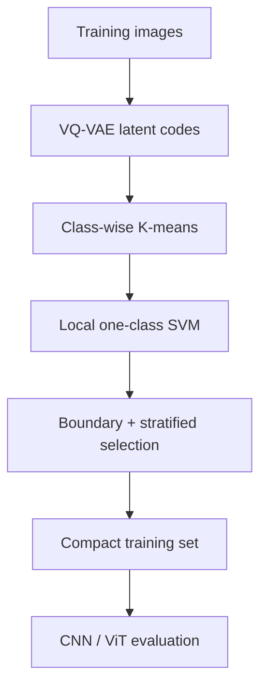

# Boundary-Aware Latent-Space Dataset Pruning

Reproducible research code for pruning redundant majority-class images with a
VQ-VAE, class-wise K-means clustering, and local one-class SVM boundary
selection. The repository unifies the original COVID-19, HAM10000, OASIS, log
analysis, and component-ablation notebooks into a configuration-driven Python
package.

The implementation supports:

- VQ-VAE training and checkpoint loading;
- latent representations based on discrete indices, normalized codebook
  histograms, or quantized embeddings;
- class-specific retention policies and uniform 25/50/75% sweeps;
- exact-size, boundary-prioritized selection with stratified margin completion;
- full preservation of non-pruned/minority classes;
- CNN, ViT, Swin, DeiT, MobileViT, PVT-v2, and TinyViT evaluation through
  `timm`;
- five-seed experiments with validation-only model selection and one final
  held-out test evaluation;
- random, no-VQ-VAE, no-K-means, no-OC-SVM, NearMiss, Tomek Links, focal-loss,
  and class-weight ablations;
- structured CSV/JSON outputs plus parsing of the original text logs.

## Method



For each configured majority class, the method allocates an exact retention
budget across clusters. Local OC-SVM support vectors and samples closest to the
decision boundary receive priority. If they do not fill the budget, the
remaining samples are drawn across ordered margin strata to preserve internal
diversity. Classes absent from the retention map remain complete.

> **Terminology:** `retention=0.25` means that 25% of the configured class is
> kept. It does not mean that 25% is removed.

## Repository layout

```text
configs/                 Dataset-specific YAML configurations
docs/                    Reproduction and output documentation
scripts/                 Colab/bootstrap and experiment helpers
src/latent_pruning/      Installable Python source package
tests/                   Lightweight deterministic unit tests
```

## Installation

Python 3.10 or newer is recommended.

```bash
python -m venv .venv
source .venv/bin/activate
python -m pip install --upgrade pip
pip install -e ".[all]"
```

For a CUDA system, install the PyTorch build matching the installed CUDA driver
before `pip install -e ".[all]"`; see the official PyTorch installation
selector. A Colab helper is also provided:

```bash
bash scripts/bootstrap_colab.sh
```

## Expected data layout

The package accepts any `ImageFolder`-style directory and scans class folders
recursively:

```text
data/COVID19/
├── train/
│   ├── COVID/
│   ├── Lung_Opacity/
│   ├── Normal/
│   └── Viral Pneumonia/
└── test/
    └── <same class folders>/
```

HAM10000 and OASIS use the same `train/<class>` and `test/<class>` convention.
Edit the paths and VQ-VAE checkpoint in the matching YAML file.

## Quick start

Validate a configuration and dataset:

```bash
latent-pruning validate-config --config configs/covid19.yaml --check-data
```

Train a VQ-VAE (optional if a compatible checkpoint already exists):

```bash
latent-pruning train-vqvae --config configs/covid19.yaml
```

Create a balanced pruned set using the class-specific retention map:

```bash
latent-pruning prune --config configs/covid19.yaml --materialize
```

Run a uniform retention level across all configured majority classes:

```bash
latent-pruning prune --config configs/covid19.yaml --retention 0.50 --materialize
```

Run all configured 25/50/75% levels:

```bash
latent-pruning prune-sweep --config configs/covid19.yaml --materialize
```

Train one classifier on the original data:

```bash
latent-pruning train-classifier \
  --config configs/covid19.yaml \
  --model resnet50 \
  --seed 42
```

Run the leakage-safe pruning + classification experiment. The original
training set is first split into fit/validation subsets; only the fit subset is
used by the pruning algorithm, and the held-out test set is evaluated once
after model selection:

```bash
latent-pruning run-experiment \
  --config configs/covid19.yaml \
  --model resnet50 \
  --retention 0.50
```

For strict isolation, the configured VQ-VAE checkpoint must also have been
trained without the classifier validation and test images (or on an external
training corpus). After `train-vqvae`, update `vqvae.checkpoint` in the YAML to
the generated `best_vqvae.pth`.

Run the component ablation suite:

```bash
latent-pruning run-ablation \
  --config configs/ham10000.yaml \
  --variants full_data_ce proposed random no_vqvae no_kmeans no_ocsvm
```

Analyze structured results or the original text logs:

```bash
latent-pruning summarize-results --input outputs --output outputs/summary
latent-pruning analyze-legacy-logs --input legacy_logs --output outputs/log_analysis
```

## Supported model aliases

| Alias | `timm` model |
|---|---|
| `resnet50` | `resnet50` |
| `xception` | `xception` |
| `vgg16` | `vgg16` |
| `efficientnet_b0` | `efficientnet_b0` |
| `vit_base` | `vit_base_patch16_224` |
| `vit_tiny` | `vit_tiny_patch16_224` |
| `deit_tiny` | `deit_tiny_patch16_224` |
| `swin_base` | `swin_base_patch4_window7_224` |
| `mobilevit_s` | `mobilevit_s` |
| `mobilevit_v2_050` | `mobilevitv2_050` |
| `pvt_v2_b0` | `pvt_v2_b0` |
| `tinyvit_5m` | `tiny_vit_5m_224` |
| `tinyvit_11m` | `tiny_vit_11m_224` |

Any other valid `timm` identifier can be supplied directly with `--model`.

## Reproducibility and outputs

The default experiment seeds are `7, 21, 42, 128, 224`. Each run records the
resolved configuration, source paths, selection manifest, class counts,
cluster-level margin metrics, training history, per-class metrics, predictions,
and confusion matrix. See [docs/REPRODUCIBILITY.md](docs/REPRODUCIBILITY.md) and
[docs/OUTPUTS.md](docs/OUTPUTS.md).

The exploratory notebooks are intentionally not bundled. The installable
package under `src/latent_pruning/` is the canonical implementation.

## Tests

```bash
python -m unittest discover -s tests -v
python -m compileall -q src tests
```


